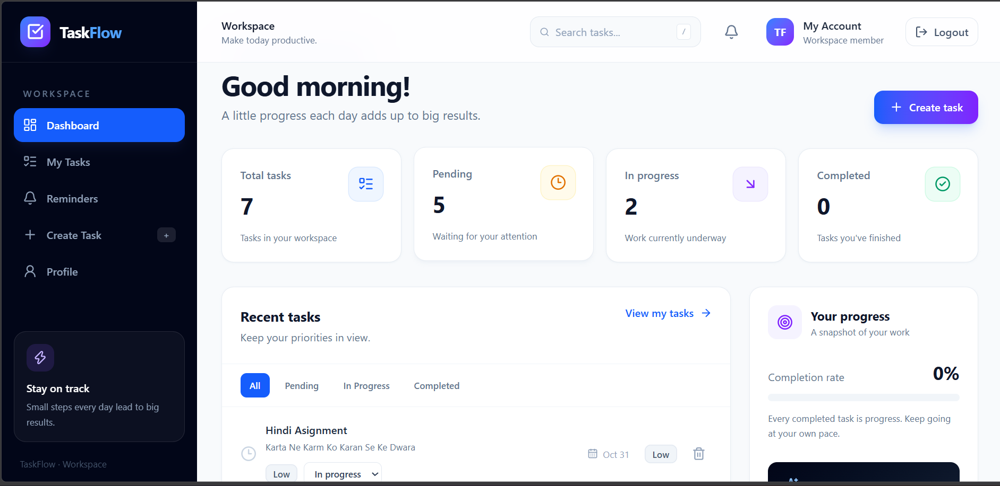
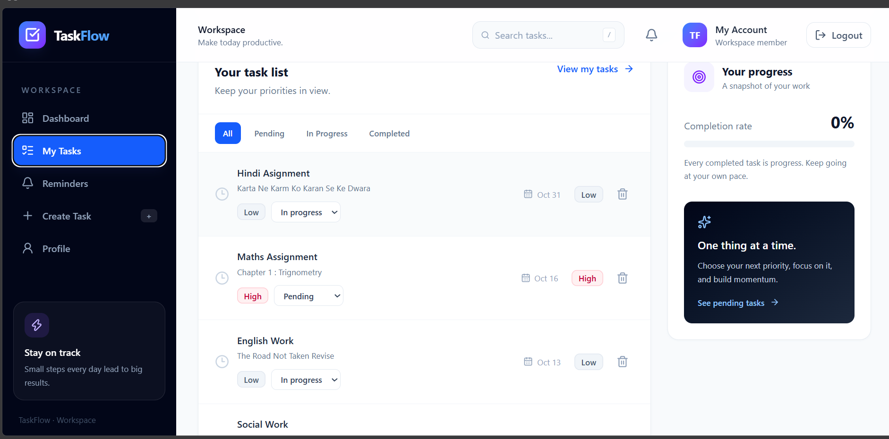
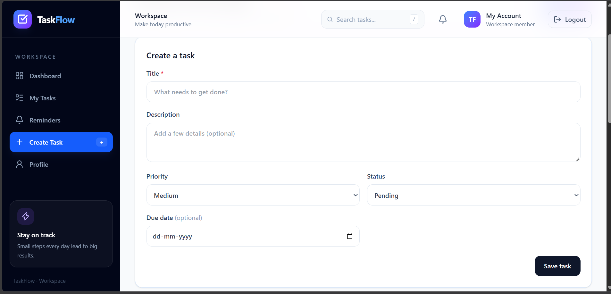
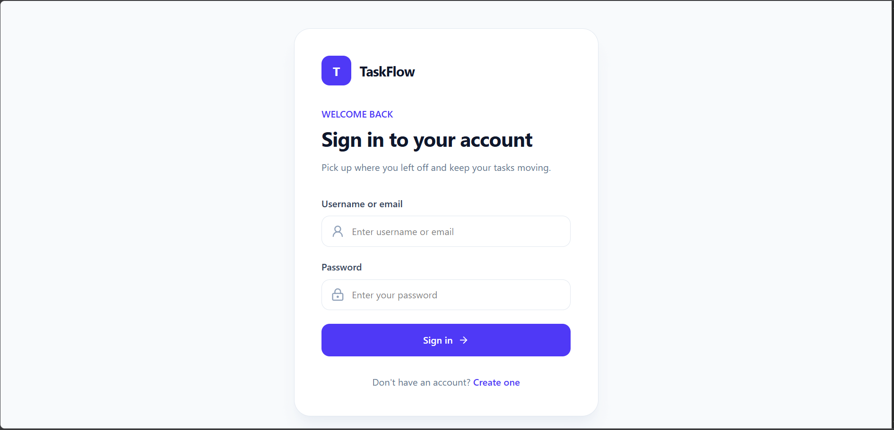

# TaskFlow

TaskFlow is a task-management application with a React frontend and a REST API built with Express and MongoDB. Users can manage their own tasks, track due dates, and review account details through a browser interface.

## Features

- Register and sign in with a username or email.
- Create, list, update, and delete tasks, with per-user task ownership.
- Filter and search tasks by status and text.
- Review overdue, due-today, and upcoming reminders; completed tasks are excluded.
- View account profile details.
- Upload profile avatars through the API using Cloudinary.
- Validate task inputs and return centralized API errors.
- Use cookie-based JWT authentication with protected API routes. Access and refresh cookies are HttpOnly; the frontend attempts a shared refresh for concurrent unauthorized requests and returns to the login flow if refresh fails.

## Tech stack

- **Frontend:** React, Vite, React Router, Axios, Tailwind CSS
- **Backend:** Node.js, Express, Mongoose, MongoDB
- **Authentication:** JSON Web Tokens and bcrypt
- **Avatar storage:** Multer and Cloudinary

## Local setup

### Prerequisites

- Node.js `^20.19.0` or `>=22.12.0`, with npm
- MongoDB
- Cloudinary credentials only if you intend to use avatar uploads

### Configure the backend

From the project root, install the backend dependencies and create a local environment file from the example:

```bash
npm install
cp .env.example .env
```

On Windows PowerShell, use `Copy-Item .env.example .env` instead of `cp`.

Configure these values in `.env`:

| Variable | Purpose |
|---|---|
| `PORT` | API port; defaults to `7000` |
| `MONGODB_URI` | MongoDB server connection URI; the application uses the `task-flow` database |
| `ACCESS_TOKEN_SECRET` | Private signing key for access tokens |
| `ACCESS_TOKEN_EXPIRY` | Access-token lifetime |
| `REFRESH_TOKEN_SECRET` | Private signing key for refresh tokens; use a different secret from the access-token secret |
| `REFRESH_TOKEN_EXPIRY` | Refresh-token lifetime |
| `CORS_ORIGIN` | Allowed browser origin; the example uses `http://localhost:5173` |
| `CLOUDINARY_CLOUD_NAME`, `CLOUDINARY_API_KEY`, `CLOUDINARY_API_SECRET` | Cloudinary configuration for avatar uploads |

Use strong private token secrets and do not commit `.env` or real credentials.

Start the API in development mode:

```bash
npm run dev
```

The production-style start script is `npm start`. The API base URL defaults to `http://localhost:7000/api/v1`.

### Configure and run the frontend

In a second terminal:

```bash
cd frontend
npm install
cp .env.example .env
npm run dev
```

On Windows PowerShell, use `Copy-Item .env.example .env`. Set `VITE_API_BASE_URL` in `frontend/.env` to the API base URL; the example points to `http://localhost:7000/api/v1`. If the frontend origin changes, update backend `CORS_ORIGIN` to match. The API enables credentialed CORS for that configured origin.

Useful frontend scripts, run from `frontend/`:

```bash
npm run lint
npm run build
```

## API overview

Base URL: `http://localhost:7000/api/v1`

| Method | Endpoint | Description |
|---|---|---|
| GET | `/health` | API health check |
| POST | `/users/register` | Register an account |
| POST | `/users/login` | Log in |
| POST | `/users/logout` | Log out and clear authentication cookies |
| POST | `/users/refresh-token` | Refresh authentication cookies |
| GET | `/users/current-user` | Get the authenticated user |
| PATCH | `/users/update-account` | Update account details |
| PATCH | `/users/avatar` | Upload a profile avatar |
| GET | `/tasks` | List the authenticated user's tasks |
| POST | `/tasks` | Create a task |
| GET | `/tasks/:id` | Get a task |
| PATCH | `/tasks/:id` | Update a task |
| DELETE | `/tasks/:id` | Delete a task |

Task priorities are `low`, `medium`, and `high`. Task statuses are `pending`, `in_progress`, and `completed`. Registration requires a password of at least eight characters. Task routes and account-update routes require authentication; login, registration, logout, and refresh-token routes are handled separately.

## Screenshots

### Dashboard



### Tasks



### Create a task



### Login



## Testing status

The frontend provides `npm run lint` and `npm run build` scripts. Authentication and API checks have also been exercised with isolated or mocked scenarios, but the full browser authentication refresh/expiry flow and integration against a real MongoDB database have not been fully verified. Do not treat those flows as fully certified by this README.

## Security notes

- The browser auth cookies are HttpOnly and use `SameSite=Lax`; the `Secure` cookie flag is enabled when `NODE_ENV` is `production`.
- Credentialed CORS should be configured for the trusted frontend origin.
- Keep secrets in local environment files, use strong distinct JWT signing secrets, and use HTTPS in production.
